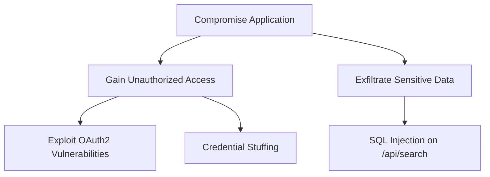

# Output format templates

## Threat Model — table column sets

Pick the column set based on application type:

### Traditional applications (Web, Mobile, Desktop, Cloud, IoT, Other)

```markdown
## Threat Model

| Threat Type | Scenario | Potential Impact |
|-------------|----------|------------------|
| Spoofing | … | … |
```

### Generative AI applications

```markdown
## Threat Model

| Threat Type | Scenario | Potential Impact | OWASP LLM |
|-------------|----------|------------------|-----------|
| Tampering | … | … | LLM01 |
```

Use `-` in the OWASP LLM column if no LLM risk applies to that threat.

### Agentic AI applications

```markdown
## Threat Model

| Threat Type | Scenario | Potential Impact | OWASP LLM | OWASP ASI |
|-------------|----------|------------------|-----------|-----------|
| Spoofing | … | … | LLM01 | ASI01 |
```

A threat may have both codes, one, or neither. Use `-` for any column where no code applies.

## Improvement Suggestions

After the table:

```markdown
## Improvement Suggestions

- Describe how user inputs are validated before being sent to the LLM.
- Clarify what sensitive data the LLM has access to via RAG or fine-tuning.
- …
```

Focus on **information gaps** that would sharpen the next iteration, not generic security advice.

## DREAD Assessment table

```markdown
## DREAD Risk Assessment

| Threat Type | Scenario | Damage Potential | Reproducibility | Exploitability | Affected Users | Discoverability | Risk Score |
|-------------|----------|------------------|-----------------|----------------|----------------|-----------------|------------|
| Spoofing | … | 8 | 6 | 5 | 9 | 7 | 7.00 |
```

Risk Score = mean of the five DREAD dimensions, rounded to 2 decimal places.

Escape any pipe characters in text fields with `\|`. Strip newlines from scenario text so they don't break the table.

## Attack Tree — Mermaid format

Always render attack trees as a Mermaid `graph TD` diagram in a fenced code block:

````markdown
## Attack Tree


````

Rules:
- Use simple snake_case IDs (root, auth, auth1, data, data1, …).
- Quote any label containing spaces, parentheses, or other special characters.
- Maintain proper parent → child relationships.
- Include all major attack paths and sub-paths.

## Mitigations table

```markdown
## Mitigations

| Threat | Suggested Mitigation |
|--------|----------------------|
| Spoofing — fake OAuth2 provider | Pin OAuth provider certificates; verify issuer URL; …  |
```

Group multiple mitigations as a bulleted list within the cell if there are several controls for one threat.

## Gherkin test cases

````markdown
## Security Test Cases

### Threat: <threat description>

```gherkin
Scenario: <what is being validated>
  Given <precondition>
  And <additional precondition>
  When <action>
  Then <expected security outcome>
  And <additional check>
```
````

One scenario per distinct threat/mitigation pair. Tests should validate that the mitigation works — i.e. the threat is blocked or detected.
